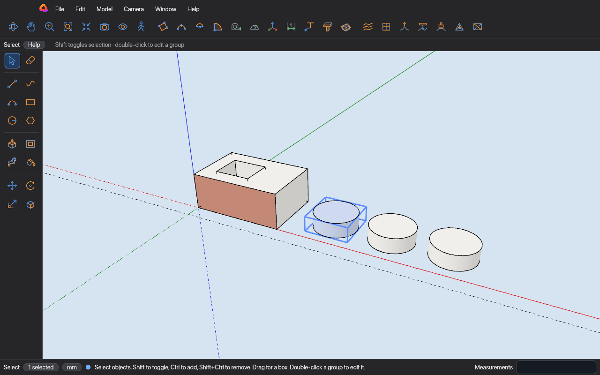

# Rysmo



A 3D modeller for architecture: buildings, rooms and furniture drawn to exact sizes.
Draw on the model, push and pull faces, and type exact sizes as you go. Runs on desktop and in the browser.
Written in Rust with Bevy and egui.

**[Open the editor in your browser](https://mojzisekjan.github.io/rysmo/editor/)**

```sh
cargo run -p rysmo_app --release
```

## License

GPL-3.0-or-later. See [LICENSE](LICENSE) and [NOTICE.md](NOTICE.md).
